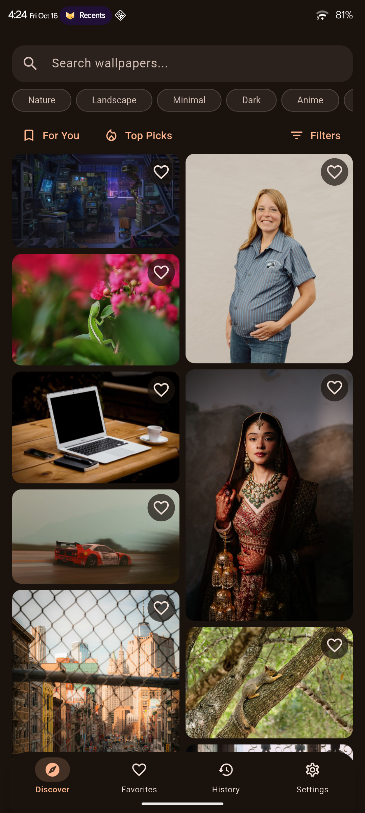

# Wallify ☁️📱

A wallpaper app for **Android**, plus a script that changes your **macOS / Linux**
desktop wallpaper on a schedule.

<a href="https://www.buymeacoffee.com/rk10" target="_blank"></a>



## Phone

Download the latest APK from [Releases](https://github.com/Ruchan10/Wallify/releases) and install it.

- Wallpapers from Wallhaven, Unsplash, Pexels, Pixabay and Lorem Picsum
- Automatic changes on a schedule, or when you plug in to charge
- Lock screen wallpapers, favorites, offline mode and home screen widgets
- API keys are entered in Settings

## Desktop

One command. It asks three questions — how often to change the wallpaper, your
API keys, and your tags — then installs and schedules everything.

**macOS**

```bash
bash <(curl -sSL https://raw.githubusercontent.com/Ruchan10/Wallify/main/desktop/mac.sh)
```

**Linux**

```bash
bash <(curl -sSL https://raw.githubusercontent.com/Ruchan10/Wallify/main/desktop/linux.sh)
```

That's it. The wallpaper changes on your chosen interval from then on
(launchd on macOS, a systemd user timer on Linux).

Run the same command again any time to change the interval, keys or tags — your
current answers come back as the defaults, and new tags are added to the ones
you have (it also asks which to remove). To stop the automatic changes, add
`--uninstall`:

```bash
bash <(curl -sSL https://raw.githubusercontent.com/Ruchan10/Wallify/main/desktop/mac.sh) --uninstall
```

Prefer to read the script first? Clone the repo and run
[`desktop/mac.sh`](desktop/mac.sh) or [`desktop/linux.sh`](desktop/linux.sh)
directly — same thing.

### After setup

```bash
~/.local/bin/wallify-desktop.sh -f    # change the wallpaper now
~/.local/bin/wallify-desktop.sh -l    # which sources are ready
~/.local/bin/wallify-desktop.sh -T    # list your tags, numbered
~/.local/bin/wallify-desktop.sh -a "ocean, night city"   # add tags
~/.local/bin/wallify-desktop.sh -r "ocean, 2"            # remove by name or number
```

Settings live in `~/.config/wallify/config` if you'd rather edit them by hand;
every option is explained in [`desktop/config.example`](desktop/config.example).

### Sources

No API key at all still gives you five sources.

| Source | API key | Uses your tags |
| --- | --- | --- |
| [Wallhaven](https://wallhaven.cc/settings/account) | Optional | ✅ |
| [Unsplash](https://unsplash.com/oauth/applications) | Required | ✅ |
| [Pexels](https://www.pexels.com/api/) | Required | ✅ |
| [Pixabay](https://pixabay.com/api/docs/) | Required | ✅ |
| Openverse | None | ✅ |
| Reddit | None | ✅ (off by default — Reddit often blocks it) |
| Bing image of the day | None | ❌ |
| [NASA](https://api.nasa.gov) picture of the day | Optional | ❌ |
| Lorem Picsum | None | ❌ |

### Desktop support

Wallpapers work on macOS, GNOME, KDE, Cinnamon, MATE, XFCE, LXQt, Hyprland,
Sway and plain X11 window managers (via `feh`, `xwallpaper` or `nitrogen`).

The lock screen gets its own, different wallpaper where the desktop allows it:
KDE Plasma, GNOME before 42, `betterlockscreen`, and lock screens that read an
image file (hyprlock, swaylock, i3lock) pointed at
`~/Pictures/Wallpapers/lock.jpg` — a symlink the script updates after every
change (`current.jpg` is the desktop image):

```ini
# ~/.config/hypr/hyprlock.conf
background {
    path = ~/Pictures/Wallpapers/lock.jpg
}
```

GNOME 42 and later, Cinnamon and macOS can't show a separate image: their lock
screen always shows the desktop wallpaper (GNOME blurs it). Set
`LOCK_SCREEN_IMAGE="same"` in the config to skip the second download elsewhere
too.

If your desktop is detected wrongly, set `WALLIFY_DESKTOP` in
`~/.config/wallify/config` to `gnome`, `kde`, `cinnamon`, `mate`, `xfce`,
`lxqt`, `hyprland` or `sway`.

## Build the app yourself

```bash
git clone https://github.com/Ruchan10/Wallify.git
cd Wallify
flutter pub get
flutter run
```

## 🤝 Contributing

Issues and pull requests are welcome.

## 📝 License

Wallify is free software, licensed under the
[GNU General Public License v3.0 or later](LICENSE).

The app bundles two unmodified MediaPipe models (Apache-2.0), downloaded from
Google's official model storage:

| File | Source | SHA-256 |
| --- | --- | --- |
| `blaze_face_short_range.tflite` | [face_detector/blaze_face_short_range/float16/1](https://storage.googleapis.com/mediapipe-models/face_detector/blaze_face_short_range/float16/1/blaze_face_short_range.tflite) | `b4578f35940bf5a1a655214a1cce5cab13eba73c1297cd78e1a04c2380b0152f` |
| `efficientdet_lite0.tflite` | [object_detector/efficientdet_lite0/int8/1](https://storage.googleapis.com/mediapipe-models/object_detector/efficientdet_lite0/int8/1/efficientdet_lite0.tflite) | `0720bf247bd76e6594ea28fa9c6f7c5242be774818997dbbeffc4da460c723bb` |

MediaPipe's built-in usage statistics are disabled: the Google transport it
reports through is replaced with no-op classes, so face detection never
leaves the device.
